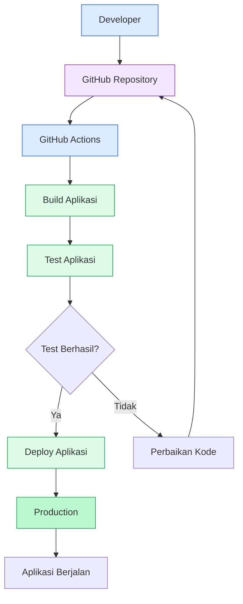

# DIAGRAM ALUR CI/CD SEDERHANA

## Pipeline CI/CD menggunakan GitHub Actions

## Penjelasan

1. Developer membuat kode program.
2. Kode dikirim ke GitHub.
3. GitHub Actions menjalankan pipeline.
4. Build digunakan untuk membangun aplikasi.
5. Test digunakan untuk menguji aplikasi.
6. Deploy mengirim aplikasi ke server.
7. Aplikasi siap digunakan.
